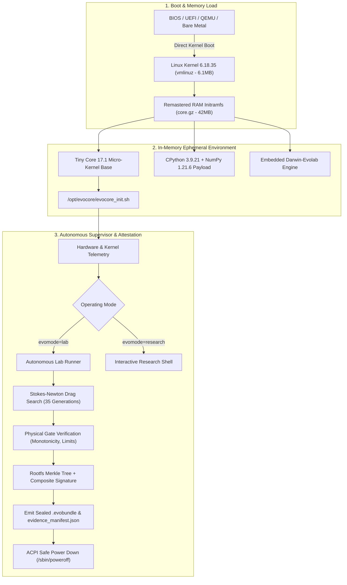
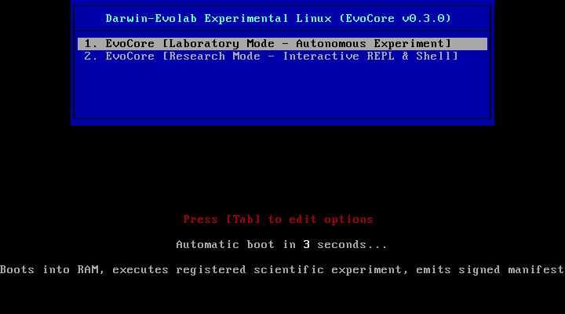
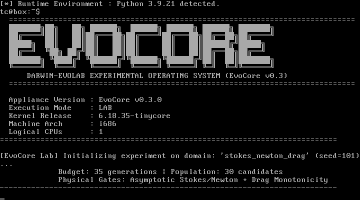
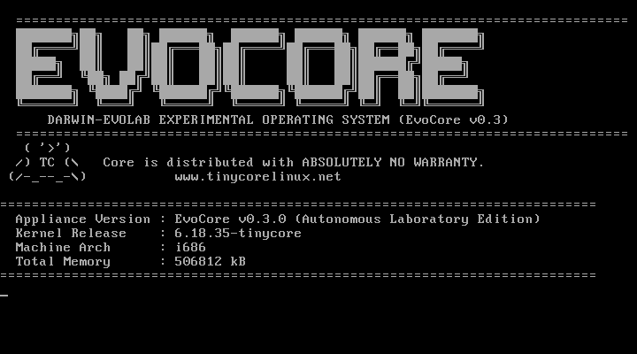

<div align="center">

```text
  ███████╗██╗   ██╗ ██████╗  ██████╗ ██████╗ ██████╗ ███████╗
  ██╔════╝██║   ██║██╔═══██╗██╔════╝██╔═══██╗██╔══██╗██╔════╝
  █████╗  ██║   ██║██║   ██║██║     ██║   ██║██████╔╝█████╗  
  ██╔══╝  ╚██╗ ██╔╝██║   ██║██║     ██║   ██║██╔══██╗██╔══╝  
  ███████╗ ╚████╔╝ ╚██████╔╝╚██████╗╚██████╔╝██║  ██║███████╗
  ╚══════╝  ╚═══╝   ╚═════╝  ╚═════╝ ╚═════╝ ╚═╝  ╚═╝╚══════╝
```

# EvoCore: Darwin-Evolab Autonomous Scientific Linux Appliance
**Minimal, Immutable, Cryptographically Attested Linux Operating Environment for Reproducible Scientific Discovery**

[](LICENSE)
[](https://github.com/bio-colab/EvoCore/releases)
[](https://github.com/bio-colab/darwin-evolab)
[](https://www.kernel.org/)
[](https://www.python.org/)
[](#cli-reference)

[English](#english) • [العربية](#arabic)

</div>

---

<a name="english"></a>
## 🌐 English Overview

**EvoCore** is an immutable, specialized, micro-kernel Linux operating appliance engineered specifically for autonomous evolutionary experiments, symbolic mathematics, and scientific law discovery.

### 🧬 Lineage & Scientific Origin
EvoCore was born from **[Darwin-Evolab](https://github.com/bio-colab/darwin-evolab)** — a multi-domain autonomous evolutionary discovery engine. While Darwin-Evolab provides the algorithmic brains (genetic algorithms, self-modeling, gate verification, and physics evaluators), **EvoCore provides its physical and computational body**: an immutable, sterile operating environment where the scientific experiment is the primary mission of the operating system itself.

---

### 🚀 Key Architectural Pillars



1. **100% Bit-for-Bit Reproducibility**:
   In science, "it worked on my machine" is unacceptable. EvoCore encapsulates the entire operating system, kernel, C libraries, Python runtime, and evolutionary algorithms into a single **hermetic appliance** verified by SHA-256 hashes and rootfs Merkle trees.
2. **Zero-Contamination RAM Execution**:
   The entire OS boots and runs purely in RAM (~69 MB disk footprint, ~400 MB RAM consumption). It leaves no traces on host storage and eliminates background OS noise or library version drift.
3. **Deep Forensic Attestation & Sealed Capsules (`.evobundle`)**:
   Every run generates deep cryptographic provenance:
   - `rootfs_merkle_root`: Deterministic Merkle hash of all filesystem inodes.
   - `kernel_sha256`: Digest of the active Linux kernel binary.
   - `specification_sha256`: Digest of canonical experiment constraints and seeds.
   - `solution_sha256`: Structural fingerprint of the discovered formula AST.
   - `composite_signature`: Cryptographic ledger uniting physical and mathematical layers.
   - Sealed `.evobundle` container packaging manifests, logs, and verification proofs.
4. **Agent-Native Dual Mode (`--json` vs Human TUI)**:
   Every command supports strict machine-readable `--json` output with deterministic exit codes for autonomous AI coding agents, alongside an ANSI-rich terminal UI and interactive REPL shell (`evocore repl`).
5. **Declarative Appliance Factory**:
   Pure-Python build and remastering engine capable of producing customized boot images from declarative profiles (`minimal`, `symbolic`, `eda`).

---

### 📸 Live Appliance Snapshots & In-Engine Telemetry

| 1. Full ISO CD-ROM Bootloader | 2. Autonomous Laboratory Mode | 3. Interactive Research Shell |
| :---: | :---: | :---: |
|  |  |  |
| *ISOLINUX hybrid bootloader menu* | *Live in-RAM Stokes-Newton physics discovery* | *Direct interactive Linux research shell* |

---

<a name="cli-reference"></a>
### 💻 Sovereign CLI Reference (`evocore`)

Install EvoCore as a system command or Python package:
```bash
pip install -e .
```

#### Core Commands

| Command | Purpose |
| :--- | :--- |
| `evocore info` | Inspect appliance environment, QEMU detection, and build artifacts |
| `evocore build` | Remaster initramfs and generate bootable ISO from declarative profile |
| `evocore run` | Launch EvoCore in QEMU (lab, research, or ISO mode) |
| `evocore evidence verify` | Forensically verify Merkle tree and cryptographic manifest integrity |
| `evocore evidence inspect` | Display discovered mathematical laws, fitness, and telemetry |
| `evocore evidence bundle` | Pack evidence manifest and logs into sealed `.evobundle` |
| `evocore evidence unpack` | Extract sealed `.evobundle` capsule to destination directory |
| `evocore profile list` | List available appliance profiles (`minimal`, `symbolic`, `eda`) |
| `evocore profile show` | View declarative specification JSON for a profile |
| `evocore repl` | Interactive shell with auto-completion and command history |

#### Agent-Native Machine JSON Mode
Appending `--json` to any command outputs strictly valid JSON on `stdout`, ideal for autonomous agent loops and CI pipelines:

```bash
# Query appliance status as JSON
evocore info --json

# Run autonomous lab experiment with sealed evidence capsule
evocore run --mode lab --headless --bundle --json

# Verify evidence authenticity programmatically
evocore evidence verify output/evidence_manifest.json --json
```

Sample JSON response:
```json
{
  "status": "success",
  "data": {
    "valid": true,
    "appliance": "EvoCore",
    "version": "0.3.0",
    "timestamp_utc": "2026-10-28 12:00:00",
    "tampered_fields": [],
    "checks": {
      "specification_integrity": { "valid": true },
      "solution_integrity": { "valid": true }
    }
  },
  "message": "Cryptographic evidence verification PASSED."
}
```

#### Deterministic Exit Codes
| Code | Identifier | Meaning |
| :---: | :--- | :--- |
| `0` | `EXIT_SUCCESS` | Command completed successfully |
| `1` | `EXIT_ERROR` | General operational error |
| `2` | `EXIT_INVALID_ARGS` | Invalid arguments or schema validation failure |
| `3` | `EXIT_QEMU_NOT_FOUND` | QEMU x86_64 emulator binary not found |
| `4` | `EXIT_ARTIFACT_NOT_FOUND`| Required ISO, kernel, or manifest file missing |
| `5` | `EXIT_ATTESTATION_FAILED`| Evidence manifest tampered or signature invalid |
| `6` | `EXIT_TIMEOUT` | VM execution exceeded allotted timeout |
| `7` | `EXIT_BUILD_FAILED` | Initramfs or ISO remastering failed |

---

### 💻 Host Launchers (Windows / Linux)

#### Windows One-Click
Within `EvoCore/`:
- **Command Prompt**: Double-click `run_evocore.bat`
- **PowerShell**: Run `.\run_evocore.ps1`

Select mode from menu:
```text
  [1] Interactive Laboratory Mode (Default GUI)
  [2] Headless Lab Runner + Sealed Evidence Capsule (.evobundle)
  [3] Research Shell Mode (Interactive Root Shell)
  [4] Full ISO CD-ROM Boot (ISOLINUX Menu)
  [5] Interactive EvoCore REPL Shell
```

---

<a name="arabic"></a>
## 🌍 نبذة باللغة العربية (Arabic Overview)

**EvoCore** هو نظام تشغيل تجريبي علمي دقيق ومستقل، مبني فوق النواة المصغرة لـ Tiny Core Linux، ومصمم خصيصاً لتشغيل تجارب التطور الرياضي والفيزيائي واكتشاف القوانين العلمية في الذاكرة الحية (RAM) مع توثيق مشفر للأدلة.

### 🧬 الأصل والنسب العلمي
نشأ **EvoCore** كبيئة تشغيل سيادية مخصصة لمشروع **[Darwin-Evolab](https://github.com/bio-colab/darwin-evolab)**. فبينما يمثل Darwin-Evolab "العقل الخوارزمي" للاكتشاف والتطور الذاتي، يمثل EvoCore "الجسد الفيزيائي والتشغيلي" — نظام تشغيل مغلق ومكتفٍ ذاتياً تكون مهمته الأساسية والوحيدة هي احتضان التجربة العلمية وإثبات صحتها بدقة البتات (Bit-for-bit).

---

### 🌟 النقلة النوعية في الإصدار v0.3.0
1. **واجهة سطر أوامر سيادية متكاملة (`evocore`)**:
   أداة متطورة تمكن الباحثين ووكلاء الذكاء الاصطناعي (AI Coding Agents) من التحكم الكامل ببناء النواة وتشغيل التجارب وتدقيق الأدلة العلمية.
2. **عقد برمجي ثنائي صارم (`--json` vs TUI)**:
   كل أمر يمكن تنفيذه بوضع `--json` ليصدر بيانات JSON قياسية نقية تماماً دون أي تشويش لوني أو شعارات نصية، مع أكواد خروج حتمية (Deterministic Exit Codes من 0 إلى 7) لمعالجة الأخطاء برمجياً.
3. **توثيق أدلة عميق وشجرة ميركل (Merkle Rootfs Attestation)**:
   - حساب بصمة شجرة ميركل (`rootfs_merkle_root`) لجميع ملفات نظام التشغيل في الذاكرة.
   - توقيع مركب يربط بين بصمة النواة، وبصمة الذاكرة، ومحددات التجربة، والقانون المكتشف.
   - حزم أدلة مشفرة ومختومة بصيغة كبسولات (`.evobundle`).
4. **صدفة تفاعلية فورية (Interactive REPL Shell)**:
   أمر `evocore repl` يوفر بيئة أوامر تفاعلية مع إكمال تلقائي (Autocomplete) وسجل أوامر محفوظ.
5. **تنفيذ معقم في الذاكرة الحية (In-Memory Execution)**:
   يقلع النظام بأكمله في RAM بحجم أقل من **70 ميجابايت** وفي أقل من ثانية واحدة، دون ترك أي أثر أو ملفات مؤقتة على القرص الصلب.

---

### 📸 لقطات حية لنظام EvoCore أثناء التشغيل الفعلي في الذاكرة

| 1. إقلاع الـ ISO الكامل | 2. الوضع المعملي الآلي | 3. صدفة البحث التفاعلية |
| :---: | :---: | :---: |
|  |  |  |
| *قائمة إقلاع ISOLINUX الهجينة للقرص المدمج* | *اكتشاف قوانين ستوكس-نيوتن فيزيائياً في الذاكرة* | *سطر أوامر لينكس تفاعلي متكامل مع بايثون* |

---

## 🛠️ Repository Structure

```text
EvoCore/
├── evocore/                 # Core Python package & CLI engine
│   ├── cli.py               # Master Click entry point (evocore)
│   ├── constants.py         # Global exit codes, paths, and metadata
│   ├── core/                # Core engines
│   │   ├── forge.py         # CPIO initramfs & ISO9660 remastering engine
│   │   ├── runner.py        # QEMU hypervisor runner & evidence extractor
│   │   ├── provenance.py    # Merkle tree hashing & cryptographic attestation
│   │   ├── bundle.py        # Sealed evidence capsules (.evobundle)
│   │   └── profile.py       # Declarative appliance profile manager
│   ├── commands/            # CLI subcommands (build, run, evidence, profile, info, repl)
│   └── utils/               # Output formatters, QEMU discovery, typed exceptions
├── profiles/                # Declarative profiles (minimal, symbolic, eda)
├── supervisor/              # Autonomous supervisor & PID 1 hooks
├── tests/                   # Automated pytest suite (22/22 passing)
├── pyproject.toml           # PEP 621 package metadata & entry points
├── run_evocore.bat          # Windows Command Prompt multi-mode launcher
├── run_evocore.ps1          # Windows PowerShell multi-mode launcher
├── evoforge.py              # Backward-compatible build engine wrapper
├── extract_manifest.py      # Backward-compatible log extractor
├── LICENSE                  # MIT Open Source License
└── README.md                # Sovereign documentation & reference
```

---

## 🤝 Contributing & Community
We welcome contributions from researchers in evolutionary computation, physics simulation, formal methods, and operating systems engineering.
- Please review [CONTRIBUTING.md](CONTRIBUTING.md) for contribution guidelines.
- Report security issues according to [SECURITY.md](SECURITY.md).
- Open issues using our structured templates in [.github/ISSUE_TEMPLATE/](.github/ISSUE_TEMPLATE/).

---

## 📄 License
EvoCore is licensed under the [MIT License](LICENSE) © 2026 bio-colab.
Upstream Tiny Core Linux components remain under their respective open-source licenses (GPL / Artistic).
